<p align="center">
  <a href="https://md8-habibullah.github.io/moon-material-simulator/">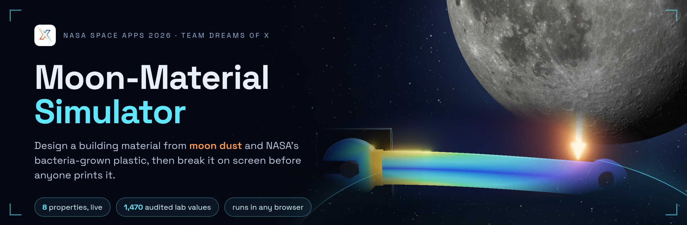</a>
</p>

<h1 align="center">Moon-Material Simulator</h1>

<p align="center">
  Design a building material from moon dust and NASA's bacteria-grown bioplastic, then see how it holds up.<br />
  <strong>Team Dreams of X · NASA Space Apps Challenge 2026</strong>
</p>

<p align="center">
  <a href="https://md8-habibullah.github.io/moon-material-simulator/"><strong>▶ Open the live simulator</strong></a> ·
  <a href="https://youtu.be/Bub3y_H-RUI">Watch the 4-minute pitch</a> ·
  <a href="https://youtu.be/kRjf5DvXlKA">30-second demo</a> ·
  <a href="#documentation">Documentation</a>
</p>

<p align="center">
  <a href="https://github.com/md8-habibullah/moon-material-simulator/actions/workflows/deploy.yml"></a>
  <a href="LICENSE"></a>
  
  
</p>

<p align="center">
  <a href="https://youtu.be/Bub3y_H-RUI">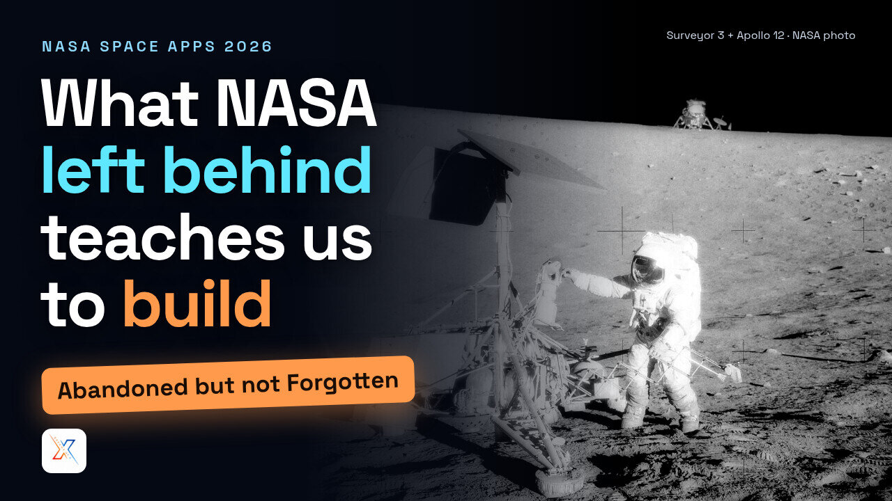</a><br />
  <sub>Short on time? <a href="https://youtu.be/kRjf5DvXlKA"><b>Watch the 30-second demo</b></a>.</sub>
</p>

---

## Our challenge: Abandoned but not Forgotten

NASA Space Apps 2026 asks teams to tell young explorers the stories of the hardware NASA left on the Moon and Mars, and
the science it made possible. We tell eight of those stories, and then go one step further: every machine left out
there is a **materials experiment that never ended**. Apollo 12 brought pieces of Surveyor 3 home after 31 months on
the Moon, and NASA found that, apart from paint darkened by dust and sunlight, nothing had seriously failed. Apollo 17
fixed a broken rover fender with maps and tape, because there are no spare parts on the Moon.

So each story ends with a **"Try it"** button: rebuild one of that machine's parts from local Moon or Mars dust and
break it in the simulator, in the conditions it would face.

<p align="center">
  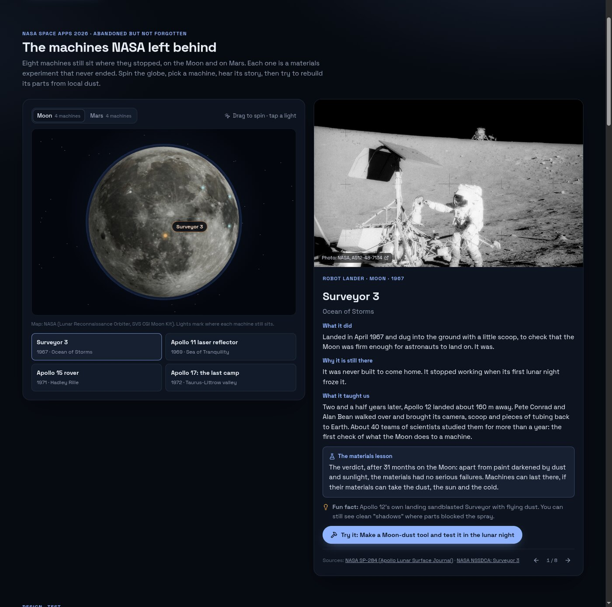<br />
  <sub><b>Stories.</b> Eight NASA machines on a Moon and Mars globe built from NASA maps. Each card has a NASA photo, what it did, why it is still there, what it taught us, a materials lesson and NASA sources.</sub>
</p>

| Moon | Mars |
| --- | --- |
| Surveyor 3 (1967), the Apollo 11 laser reflector (1969), the Apollo 15 rover (1971), Apollo 17's lander and taped fender (1972) | Viking 1 (1976), Sojourner (1997), Opportunity (2004), Ingenuity (2021) |

## The problem

One broken tool on the Moon can mean months of waiting and a resupply launch at up to **$1 million per kg**
(NASA Glenn, [NTRS 20260007758](https://ntrs.nasa.gov/citations/20260007758)). In September 2026, NASA Glenn Research
Center [showed a new material](https://www.nasa.gov/image-article/nasa-made-material-moon-manufacturing/) that could
be made on site: a **biodegradable plastic grown inside bacteria** fed with CO₂ or crew waste, mixed with **simulated
Moon and Mars dust**. NASA names brackets, wrenches and chairs as first uses.

The open question is which mix to make. With 10% regolith or 50%? Lunar or Martian dust? Is it strong enough for a
wrench, or heat-resistant enough for a sunlit wall panel? You can't test every combination on Earth, and you can't
afford to get it wrong on the Moon.

<table>
  <tr>
    <td align="center" width="50%">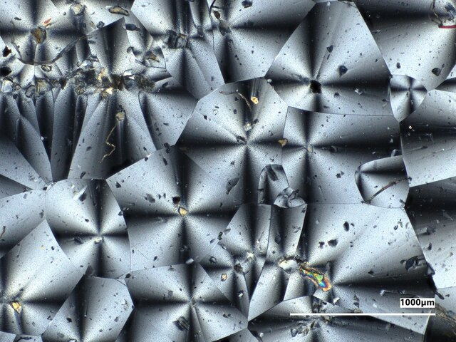<br /><sub><b>Moon dust simulant</b> in the bioplastic, 100×</sub></td>
    <td align="center" width="50%">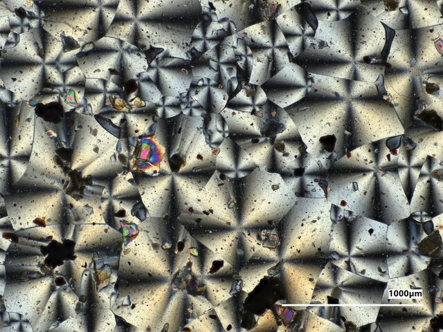<br /><sub><b>Mars dust simulant</b> in the bioplastic, 100×</sub></td>
  </tr>
</table>
<p align="center"><sub>Microscope images: NASA Glenn Research Center (public domain).</sub></p>

## What we built

An interactive simulator for designing these composites, which runs entirely in the browser:

| Step | What you do | What happens |
| --- | --- | --- |
| **Learn** | Spin the Moon or Mars globe and open a machine's story. | A kid-friendly card: NASA photo, what it did, why it is still there, what it taught us about materials, and a "Try it" button that opens the part test with that machine's part, place and local dust. |
| **Design** | Pick a binder (NASA's bacterial PHB, PLA, PEEK, LDPE, PEI or PPSU), a soil (lunar highlands, lunar mare, Martian) and how the part is made (filament or pellet printing, injection molding, hot pressing, pressed + sintered brick); set regolith % (up to 92.5), basalt fibre %, grain size and operating temperature. | A physics model, corrected by machine learning on **real lab measurements**, predicts **8 properties** live with uncertainty bands. Every value says whether it is lab-backed or a physics estimate, and one click shows the real measurements behind it, down to the table cell in the paper. |
| **Test** | Fly around the 3D microstructure (drag, zoom, full screen) and watch it print layer by layer; load a wrench, a shelf bracket or a shelter brick until it breaks, in the habitat, at lunar noon or at lunar night; see a polarised-light view styled after NASA's micrographs and property-vs-loading curves with NASA's measured points on top. Optional sound. | The part test colours stress from beam and column formulas on the model's predicted strength and stiffness, and reports the breaking load, the safety factor against a stated design load, and whether the part bends or snaps. Every mix is also checked against six real uses (wrench, bracket, chair, lunar wall panel, Mars shelter block and thruster nozzle) at the temperatures each one must survive. |
| **Optimize** | Choose a use. | The optimizer tests about 5,000 compositions (every binder, with each process it has lab data for) and ranks the passing ones, most locally sourced first. It says honestly when nothing works: no plastic survives a thruster nozzle. |
| **Plan** | Compare up to four formulas; estimate mission impact. | Radar chart, winners per property and CSV export, plus launch mass and cost avoided by printing parts on site. |

<p align="center">
  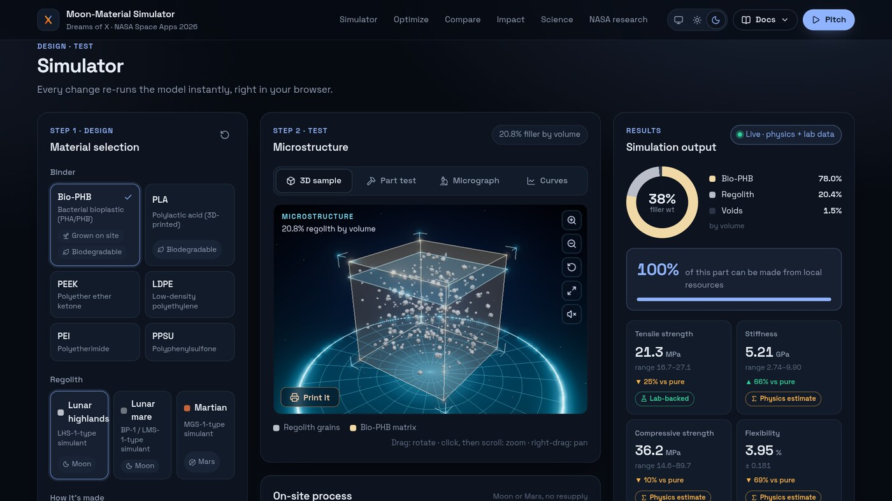<br />
  <sub><b>Design.</b> Pick the binder, soil, process and loading; eight properties update instantly, each marked lab-backed or physics estimate.</sub>
</p>

**Who it's for.** Engineers and mission planners who want to choose a mix before a single sample is printed, and just as
much students, teachers and anyone curious about rockets, NASA and space. It is free, runs in any browser, and every
number links to the NASA report or paper it comes from, so it works as a classroom tool too.

### Test it before you print it

<table>
  <tr>
    <td align="center" width="50%">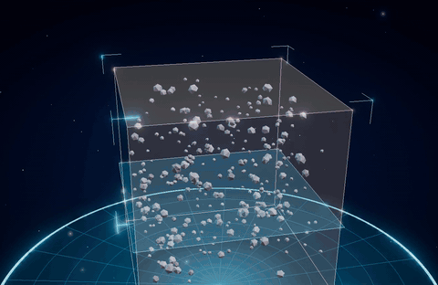<br /><sub><b>Print it.</b> The 3D sample builds layer by layer, grains at the real loading. Drag to orbit, scroll to zoom.</sub></td>
    <td align="center" width="50%">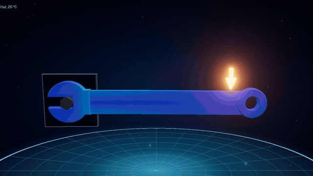<br /><sub><b>Break it.</b> PHB + 38% lunar dust: stress climbs from blue to red, and it snaps at 71 N, just short of the 72 N a bolt needs.</sub></td>
  </tr>
  <tr>
    <td align="center">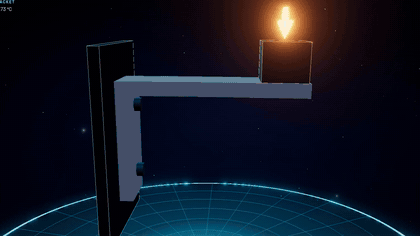<br /><sub><b>Shelf bracket.</b> Cantilever bending, σ = F·L/Z.</sub></td>
    <td align="center">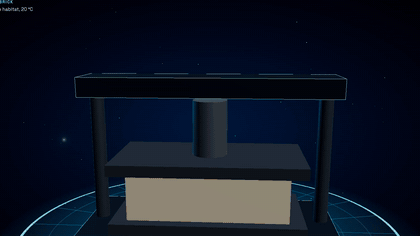<br /><sub><b>Shelter brick.</b> Crushed under a 2 m wall plus 3 m of regolith shielding.</sub></td>
  </tr>
</table>

### Let the optimizer find the mix

<table>
  <tr>
    <td align="center" width="58%">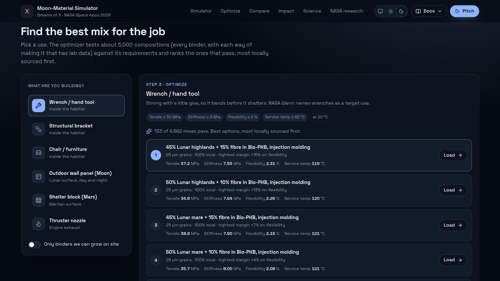<br /><sub><b>Wrench:</b> about 5,000 mixes tested, ranked most locally sourced first.</sub></td>
    <td align="center" width="42%">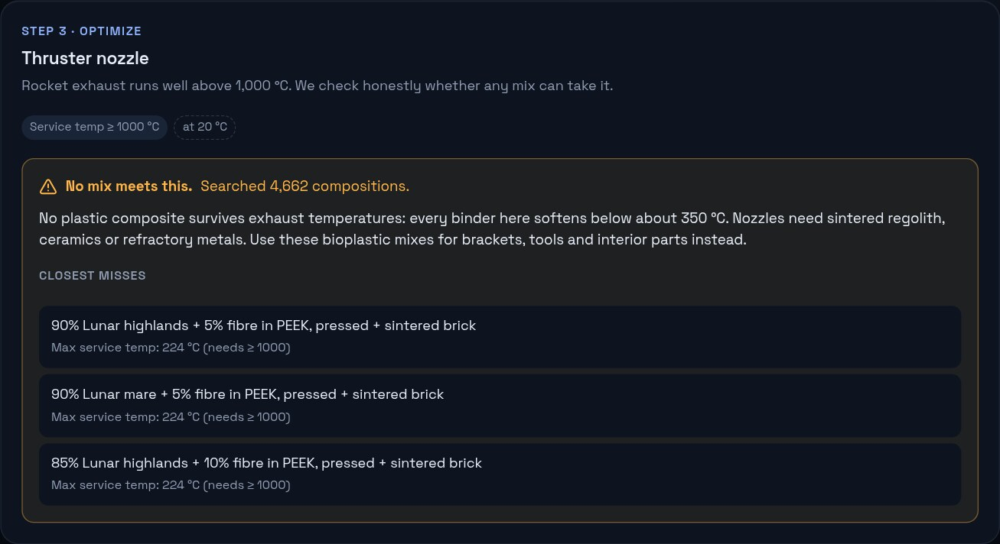<br /><sub><b>Thruster nozzle:</b> it says no, honestly. No plastic survives 1,000 °C.</sub></td>
  </tr>
  <tr>
    <td align="center">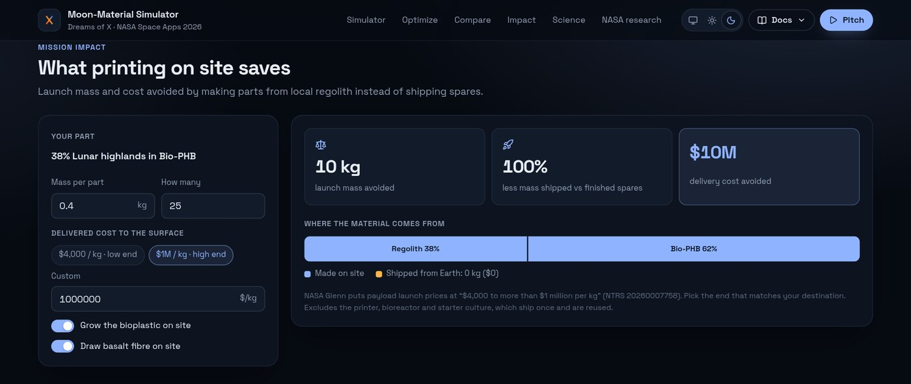<br /><sub><b>Mission impact:</b> launch mass and cost avoided by printing on site.</sub></td>
    <td align="center">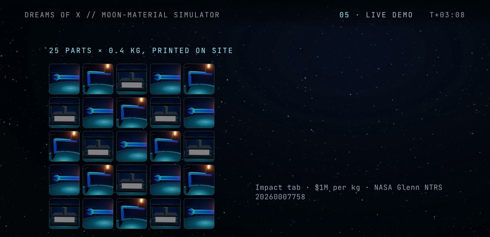<br /><sub>25 small parts printed on site keep 10 kg off the launch pad.</sub></td>
  </tr>
</table>

## Built on real, audited data

We transcribed **1,470 values from 11 sources** (5 NASA reports and 6 peer-reviewed or preprint studies). Each one
is tied to its page, table, row and column, and our **Evidence Auditor** re-found every one in its source PDF. It
reports 0 transcription errors. It also documents 181 problems inside the papers themselves, such as swapped 0°/90°
values, MPa written for GPa, and an impossible −273 °C glass transition. The original 56 NASA calibration points
all passed an independent re-read. Details: [docs/evidence.md](docs/evidence.md) and
[docs/data_sources.md](docs/data_sources.md).

<table>
  <tr>
    <td align="center" width="50%">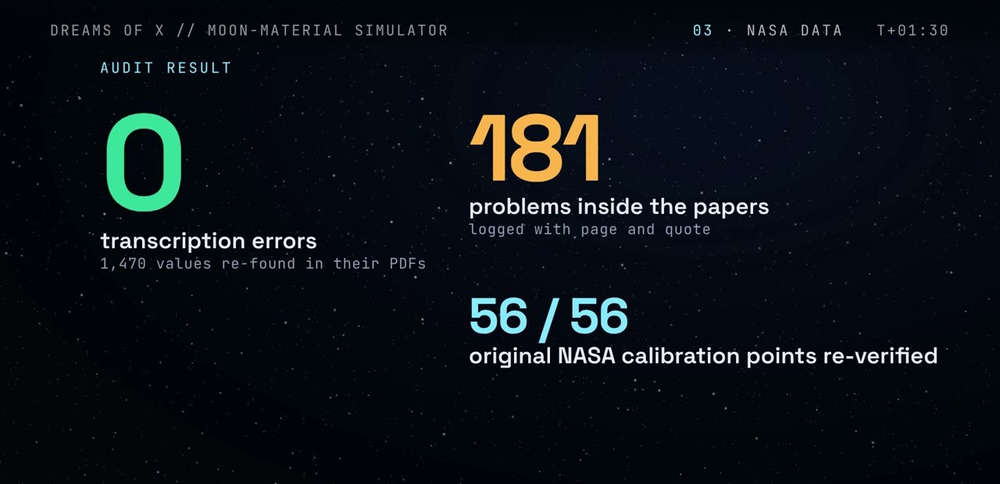<br /><sub><b>Audit result.</b> Every value re-found in its PDF.</sub></td>
    <td align="center" width="50%">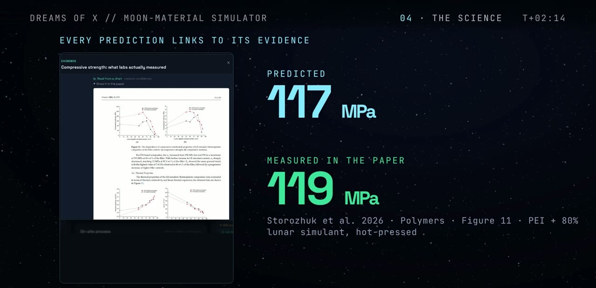<br /><sub><b>Every prediction links to its evidence.</b> Predicted 117 MPa; the paper measured 119.</sub></td>
  </tr>
  <tr>
    <td align="center">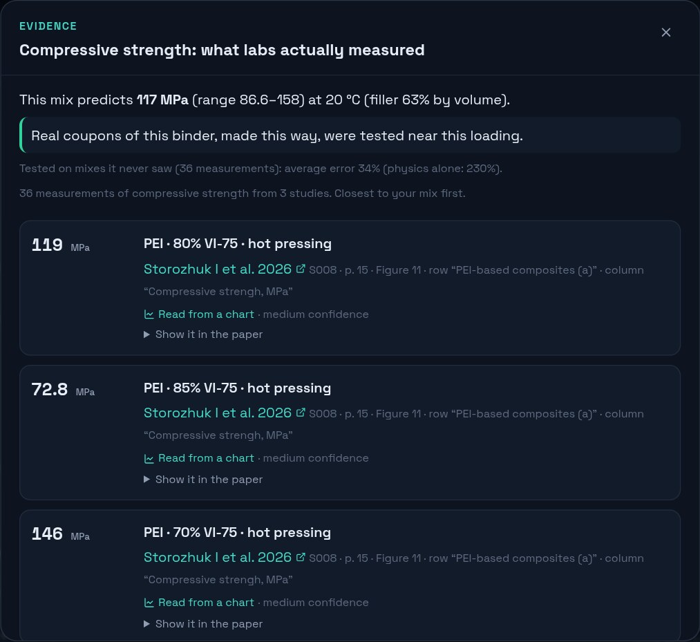<br /><sub>The evidence drawer: the measurements behind a number, with paper, figure and confidence.</sub></td>
    <td align="center">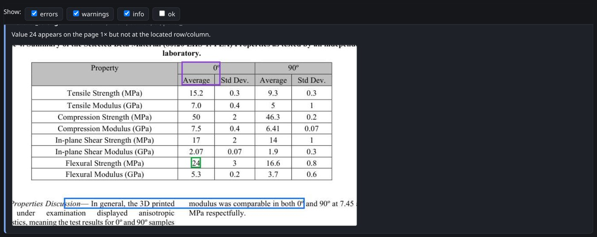<br /><sub>The Evidence Auditor marks the exact cell in the source PDF.</sub></td>
  </tr>
</table>

| NASA source | What we used |
| --- | --- |
| [NASA Glenn: "Under the Microscope" (Sep 2026)](https://www.nasa.gov/image-article/nasa-made-material-moon-manufacturing/) | The core idea and target uses |
| [NTRS 20260007758: Christy, NASA Glenn, ACS 2026](https://ntrs.nasa.gov/citations/20260007758) | PHB + five lunar/Martian simulants: tensile strength (slide 17), decomposition temperature and crystallinity (slide 9), launch-cost range |
| [NTRS 20260003641: Christy et al., NASA Glenn, 2026](https://ntrs.nasa.gov/citations/20260003641) | Processing routes, loadings up to 80 wt% |
| [NTRS 20230015024: Gelino et al., NASA Kennedy, 2023](https://ntrs.nasa.gov/citations/20230015024) | Binder properties at room temperature and 77 K (Appendix Table 8); 18 measured 3D-printed LHS-1/BP-1 + PLA results (Tables 2–4) |
| [NASA Technical Reports Server API](https://ntrs.nasa.gov) | A searchable index of related NASA reports inside the app (live when the backend runs; a snapshot on the hosted site) |

**Accuracy, tested on real data the model never saw.** We used 152 first-hand measurements from 7 studies to
predict untested mixes:

| Property | Physics alone | With the lab-data correction |
| --- | --- | --- |
| Compressive strength | 230% | **34%** |
| Stiffness | 65% | **19%** |
| Density | 16% | **5%** |
| Thermal conductivity | 32% | **7%** |
| Tensile strength | 19% | **18%** |

<p align="center">
  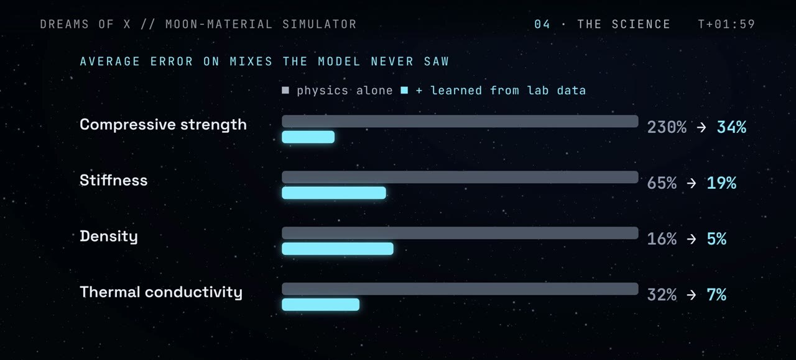
</p>

The uncertainty is calibrated on held-out mixes (90% fall within its 90% band). The app shows the likely (about
68%) range, worked out in log space because the errors are multiplicative, so a wide range reads "14.6–89.7 MPa"
instead of a ± that would dip below zero. Leaving a whole study out is harder: a
manufacturing route seen in only one study can't be learned from the others. We report that too. See
[docs/science_model.md](docs/science_model.md).

**Honest limits.** 152 measurements is a small, patchy dataset: each study tested one binder and one process. Where
there is no lab data near a mix, the app says "Physics estimate". Use the numbers to explore trends and shortlist
mixes, not as qualified design values.

## How it works

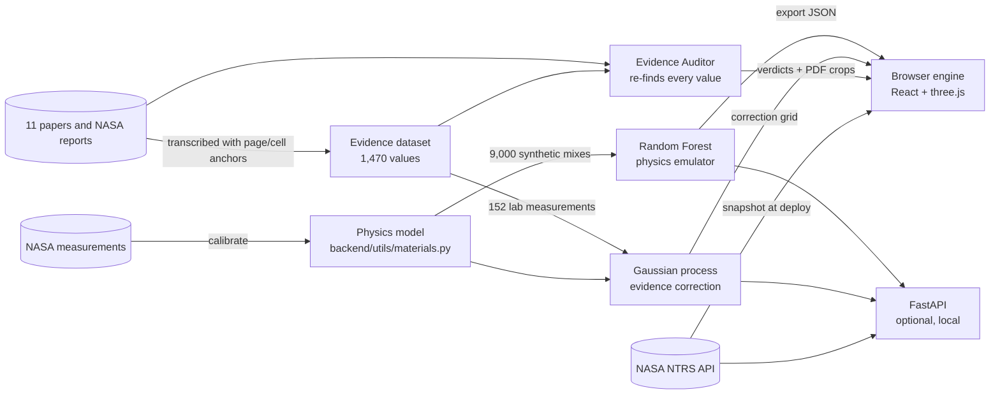

1. **Physics-informed features.** The mix is turned into volume fractions, grain bond, porosity and density, computed
   identically in Python and JavaScript.
2. **Random Forest (physics emulator).** 28 trees reproduce the calibrated physics model so it runs in the browser.
3. **Evidence correction.** A Gaussian process learns how far real coupons sit from the physics, per binder and
   process. Near lab data the prediction follows the data; far from it, it falls back to physics with a wider ±.
4. **Temperature physics.** NASA's measured 77 K ratios on the cold side; softening around the predicted service
   temperature on the hot side.

The hosted site runs the exported forest in your browser, and a parity test checks it against Python on 60 random
mixes. More in [docs/architecture.md](docs/architecture.md).

<table>
  <tr>
    <td align="center" width="60%">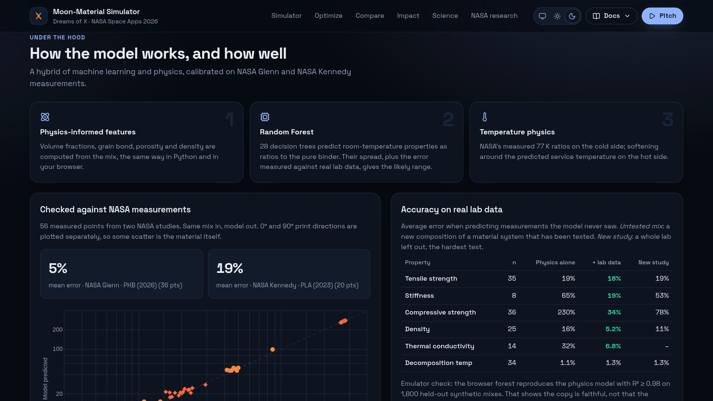<br /><sub>Inside the app: how the model works, and how well.</sub></td>
    <td align="center" width="40%">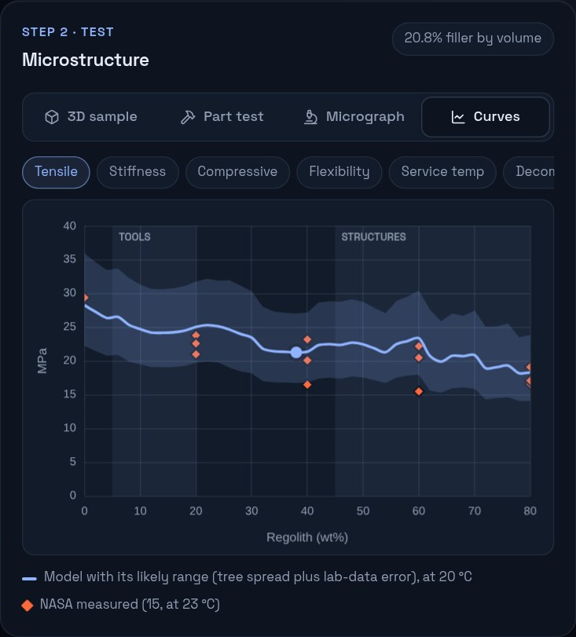<br /><sub>Property vs loading, with the likely range and NASA's measured points.</sub></td>
  </tr>
</table>

<p align="center">
  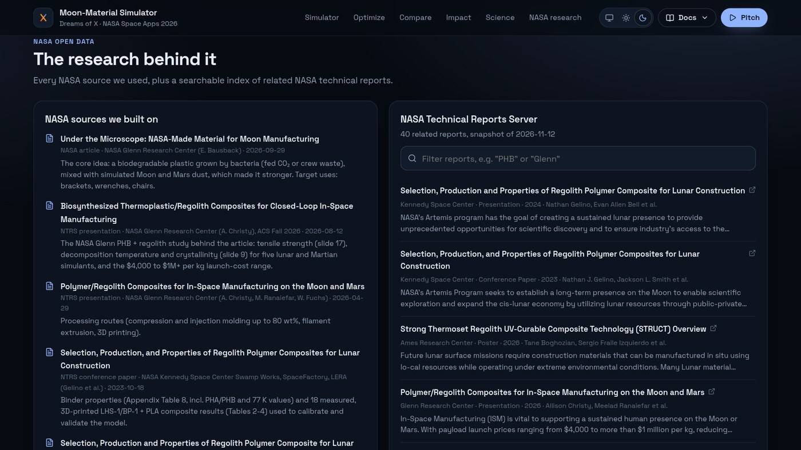<br />
  <sub>The research behind it: every NASA source, plus a searchable NASA Technical Reports Server index.</sub>
</p>

## Run it locally

You need Python 3.11+ and Node.js 20.19+.

```bash
# 1. Frontend only (the model runs in the browser): http://127.0.0.1:5173
cd frontend
npm install
npm run dev

# 2. Optional backend for the REST API and live NASA NTRS search: http://127.0.0.1:8000/docs
cd backend
python -m venv .venv && source .venv/bin/activate   # Windows: .venv\Scripts\activate
pip install -r requirements-dev.txt
uvicorn main:app --reload --host 127.0.0.1 --port 8000
```

To change the science and retrain:

```bash
python research/download_sources.py  # fetch the source PDFs (not in git) and check their hashes
cd backend
python -m evidence.build             # merge research/extraction/*.csv into data/evidence/measurements.csv
python -m evidence.audit             # re-check every value against its PDF -> research/audit/
python -m data.generate_dataset      # rebuild the synthetic physics training set
python -m scripts.export_frontend    # retrain forest + evidence GP, export model, evidence and catalog
pytest                               # 64 tests: API, science, evidence auditor, evidence model, export parity
cd ../frontend && npm test           # browser engine matches Python; evidence correction; optimizer; mission maths
```

## Documentation

| Document | What's in it |
| --- | --- |
| [Architecture](docs/architecture.md) | Components, data flow, design decisions |
| [Science model](docs/science_model.md) | Every equation, the NASA calibration, the evidence correction and its validation, limitations |
| [Evidence pipeline and auditor](docs/evidence.md) | Sources, transcription rules, how the auditor checks every value, what it found |
| [Data dictionary](docs/data_dictionary.md) | Inputs, outputs, ranges and dataset columns |
| [NASA data sources](docs/data_sources.md) | Each NASA source and exactly how it is used |
| [API reference](docs/api.md) | FastAPI endpoints with examples |
| [Deployment](docs/deployment.md) | GitHub Pages setup and the CI pipeline |
| [Demo script](docs/demo_script.md) | A two-minute walkthrough for judges, starting with the Stories |
| [240-second video script](video/README.md) | The Space Apps "240 Seconds of Glory" video: second-by-second script, voice-over, shot list, assets and style guide |

## Tech stack

| Layer | Tools |
| --- | --- |
| Frontend | React 19, Vite 8, three.js, Chart.js, lucide icons |
| In-browser ML | Exported scikit-learn Random Forest (custom JS evaluator) + Gaussian-process correction grid |
| Evidence | PyMuPDF (PDF auditing and crops), SciPy (GP fitting) |
| Backend | Python 3, FastAPI, Pydantic |
| Science and ML | scikit-learn, NumPy, pandas |
| Hosting and CI | GitHub Pages, GitHub Actions |

## Project structure

```text
moon-material-simulator/
├── research/
│   ├── sources.csv                 # 13 sources: citation, licence, PDF link, SHA-256
│   ├── EXTRACTION_SPEC.md          # How values are transcribed (page/table/row/column anchors)
│   ├── extraction/                 # One CSV + issues log per source
│   ├── audit/                      # Auditor output: comments CSV, HTML report, index
│   └── legacy/                     # The team's first extraction pipeline (Yousuf Abdullah), used as a coverage check
├── backend/
│   ├── evidence/                   # Evidence build + auditor (PyMuPDF)
│   ├── models/evidence_model.py    # Gaussian-process correction on real measurements, with validation
│   ├── main.py                     # FastAPI app: predict, compare, catalog, validation, NTRS search
│   ├── utils/materials.py          # Material catalogue + physics model (NASA-calibrated)
│   ├── utils/applications.py       # Uses the optimizer designs for (wrench, panel, nozzle...)
│   ├── utils/data_processor.py     # Physics-informed features shared with the browser
│   ├── models/property_model.py    # Random Forest: training, prediction, JSON export
│   ├── services/                   # NTRS client, catalog builder
│   ├── scripts/export_frontend.py  # Writes frontend/src/generated/*
│   ├── data/                       # Synthetic dataset, NASA reference points, generator
│   └── tests/                      # API, science-vs-NASA and export-parity tests
├── frontend/
│   ├── src/lib/engine/             # Browser engine: forest, physics, optimizer, mission maths
│   ├── src/components/             # Stories (relics), simulator, optimizer, comparison, impact, science, research
│   ├── src/lib/relics.js           # The 8 NASA machines: stories, coordinates, photos, sources, "Try it" tests
│   ├── public/relics/              # NASA photos and the Moon and Mars maps for the globe
│   ├── src/generated/              # Model + catalog exported from Python
│   └── test/                       # Node tests for the engine
├── docs/                           # Architecture, science, data, API, deployment, demo
│   └── assets/readme/              # README banner, screenshots and GIFs
├── video/                          # 240-second pitch film: script (README.md) and HyperFrames project
└── .github/workflows/deploy.yml    # Test, build and publish to GitHub Pages
```

<p align="center">
  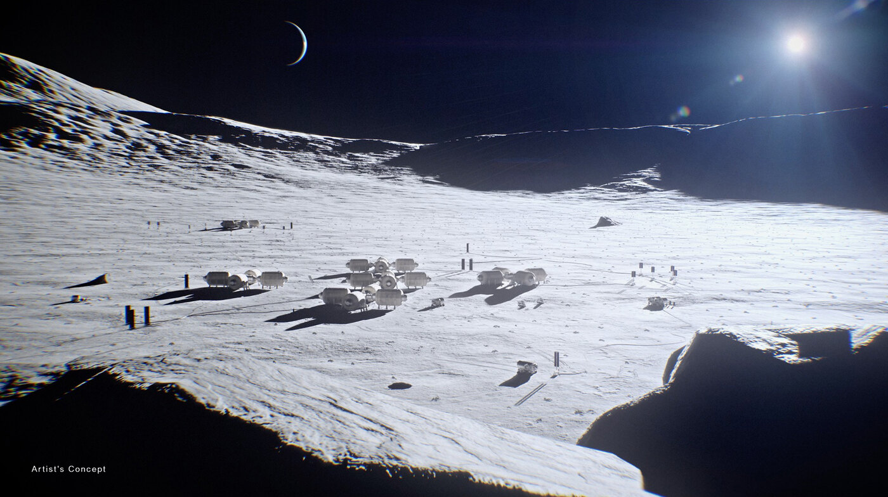<br />
  <sub><i>Every kilogram made on the Moon is a kilogram we don't have to launch.</i> · Concept art: NASA</sub>
</p>

## Team: Dreams of X

| Member | Role | Contribution |
| --- | --- | --- |
| **Mahdin Islam Mukim** | Team Lead | Leads the team |
| **Maliha Sanjana** | UI/UX Designer | Design |
| **Lamisa Yeasmin Nakia** | Research & Storytelling Lead | Research and storytelling |
| **Yousuf Abdullah** | AI/ML Researcher · Data Scientist | Research and data analysis, the AI models, the dataset and the source papers. His first extraction pipeline lives in [`research/legacy/`](research/legacy/README.md). |
| **Md. Habibullah Sharif** | Systems Architect | The architecture and the whole app: UI/UX, the 3D views and part tests, the simulator engine, the evidence pipeline and the backend |

Five friends, one team: we researched, designed, built and tested it together.

## Use of AI

- **Claude (Anthropic), through Claude Code**, helped us write and debug the code (frontend, backend, models, evidence
  auditor), transcribe values from the public NASA reports and open-access papers into CSV files, draft the
  documentation, and build the videos in HyperFrames. Every transcribed value is re-checked against its source PDF by
  the auditor, and we reviewed and tested all code and text.
- **ElevenLabs** (AI text-to-speech) is the narration voice in both videos, reading our own script. Each video says so
  in its credits, its description and its file metadata.
- **Our own models** inside the app: a Random Forest trained on our physics model and a Gaussian-process correction
  trained on 152 real lab measurements.
- No AI-generated images or music: photos and maps are NASA's, app images are our own screenshots and renders, the music
  is synthesised by our own code (`video/film/tools/music.py`) and the sound effects come from Pixabay.

## License 

[MIT](LICENSE). NASA material is used as public-domain U.S. Government work and cited throughout. This project is not
endorsed by NASA. README images: app screenshots and recordings are from this project; microscope images and concept
art are NASA's; the Moon in the banner is rendered from NASA LRO maps (SVS CGI Moon Kit).


---
