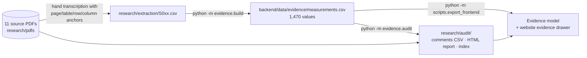

# Evidence pipeline and auditor

[← Back to README](../README.md) · Code: [`backend/evidence/`](../backend/evidence/) · Data: [`research/`](../research/)

The simulator learns from real lab measurements. Every one of them can be traced to an exact spot in a
source PDF and has been re-checked against that PDF by an automatic auditor. The auditor never edits data: it
only writes comments, and people decide what to change.

## 1. Sources

[`research/sources.csv`](../research/sources.csv) lists every source: title, authors, DOI or NTRS id, licence,
type (experimental / simulation / abstract / database), a direct PDF link and the SHA-256 of the file we
transcribed. `python research/download_sources.py` fetches the PDFs and checks the hashes. The PDFs themselves
are not committed.

| ID | Source | What it adds |
| --- | --- | --- |
| S001 | Li et al. 2020, *Polymers* 12:1724 | PLA + CLRS-1 (0-10 wt%), filament printing: tensile, flexural, DSC/TGA, porosity |
| S002 | Alexander-Roy et al. 2025, *Polymers* 17:2685 (NASA Glenn co-authors) | Basalt-moon-dust PLA vs PLA under 8 print settings (filler content not stated, so not used for training) |
| S003 | Gelino et al., NASA KSC, NTRS 20230015024 | PLA + LHS-1 / BP-1 pellet printing at 61-78 wt%: Tables 1-8, incl. 15 polymers at RT and 77 K |
| S004 | Torre et al. 2025, *Applied Sciences* 15:679 | Regolith-rich PEEK bricks (85-95 wt%), cold-compacted and sintered, air and vacuum cured |
| S005 | Preprint 202606.1562 (2026) | FEM of regolith-filled PEEK (simulation, kept separate) |
| S006, S011 | Christy et al., NASA Glenn, NTRS 20260003641 and 20260007758 | Bacterial PHB + LMS-1, LSP-2, LHS-1, MGS-1, JEZ-1 at 20-80 wt%: tensile, decomposition, crystallinity |
| S007 | Moazen et al. 2025, *Acta Astronautica* 237 | LDPE + LMS-1D (0-30 wt%), filament printing: tensile, warpage |
| S008 | Storozhuk et al. 2026, *Polymers* 18:2371 | PPSU and PEI hot-pressed with 50-92.5 wt% lunar simulant: compression, density, conductivity, CTE, Tg |
| S009 | IAC 2020 brief and NDSU abstract | Polypropylene and MDPE with Martian simulants (abstracts only: no numbers) |
| S010 | Gasteiner et al. 2026, arXiv 2602.03829 | The open lunar regolith database (soil properties, not composites) |
| S012 | NASA KSC presentation, NTRS 20240004186 | Companion slides to S003 (duplicates marked) |
| S013 | NASA, NTRS 20030020808 (scanned 2003 report) | Polyethylene/regolith compression and radiation-shielding results |

## 2. Transcription

Values were transcribed per [`research/EXTRACTION_SPEC.md`](../research/EXTRACTION_SPEC.md): one row per
number, with the PDF page, table or figure, the row and column labels as printed, the number exactly as printed
(`value_raw`), its unit, the mix (binder, simulant, target and measured filler wt%), the process, the test
temperature, and whether it is experimental or simulated, first-hand or cited. Chart readings are marked
`chart_digitized` with a confidence and the axis range used. Problems found inside the papers themselves go in
`research/extraction/S0xx_issues.md`.

Totals: 1,470 values (765 from tables, 129 from text, 576 read from charts), of which 313 are values a paper
quotes from other work (kept, but marked `CITED` and not used for training).

`python -m evidence.build` merges them into `backend/data/evidence/measurements.csv`, adding a stable `obs_id`,
the value in a canonical unit, and the effective filler content. It changes no transcribed value.

## 3. The auditor

`python -m evidence.audit` re-finds every value in its PDF with PyMuPDF and writes:

- `research/audit/audit_comments.csv`: one row per finding (severity, verdict, location, our value, what the
  source holds, comment)
- `research/audit/audit_report.html`: a self-contained report. Each finding that needs a human look shows a crop
  of the page with coloured boxes (row label, column header, our value, what the cell really holds).
- `research/audit/audit_index.json`: the verdict and location of every value, used by the website

**How it locates a table cell.** It finds the cited table's caption, then the row label and the column header
inside that table. Labels may wrap over lines ("80/20 LHS-" / "1/PLA") or sit under a spanning header ("Pore Size"
over "Length | Width"). A 0°/90° sub-row is found from the orientation. Where the row and column meet, it compares
the number in the cell with ours. A cell like "64.3 ± 3.3" counts if our number is in it. It only calls an error
when both the row and the column were located with confidence; otherwise it reports the strongest evidence it has,
such as "found on the row".

| Verdict | Meaning |
| --- | --- |
| `CELL_MATCH`, `TEXT_MATCH`, `ROW_MATCH`, `SPLIT_MATCH` | Found where cited (`SPLIT_MATCH`: printed across two text fragments) |
| `PAGE_MATCH` | On the cited page, but the cell position could not be confirmed |
| `CHART_ESTIMATE`, `SCAN_VISUAL` | Chart reading or scanned page: check by eye against the attached image |
| `CELL_MISMATCH`, `WRONG_ROW`, `WRONG_COLUMN` | The cell holds another number; our number is elsewhere (e.g. swapped 0°/90°) |
| `UNIT_MISMATCH`, `UNIT_SUSPECT`, `UNIT_UNCONVERTIBLE` | A factor of 1000 apart, physically implausible, or an unknown unit |
| `ROUNDING`, `WRONG_PAGE`, `NOT_FOUND`, `DUPLICATE`, `SCHEMA`, `VOCAB` | As named |
| `COMPOSITION` | Measured filler content differs from the target (the model uses the measured value) |
| `CROSS_SOURCE_SPREAD` | Different labs disagree by more than 25% on a comparable mix |
| `SOURCE_ISSUE` | A problem inside the paper itself, from the transcribers' issue logs |
| `MODEL_REFERENCE_*` | The simulator's original calibration points checked against the evidence |
| `POSSIBLE_MISSED_VALUE` | A number the earlier automatic extraction found that the dataset doesn't contain |

Tests in [`backend/tests/test_evidence.py`](../backend/tests/test_evidence.py) plant errors in NASA KSC's tables
(a swapped orientation, a wrong column, a ×1000 unit slip, rounding, a wrong page) and check that each gets the
right verdict.

### Current result

- **0 errors** in the transcription across 1,470 values. 390 values were confirmed cell by cell, 107 in text,
  186 on their row. 576 chart readings and the 281 values from the scanned 2003 report are marked for visual
  checks, with the page image attached.
- **All 56 calibration points of the original simulator match the evidence**, re-read independently from the
  same NASA slides and tables.
- **181 problems inside the papers themselves**, each with page and quote. Examples:
  - NASA KSC (S003) swaps the 0° and 90° flexural strengths in its text (16.55/23.86 MPa vs Table 4's 24/16.6),
    writes MPa where its table says GPa, and lists an impossible −273 °C glass transition in Table 8.
  - Figures 12-13 of S003 assign bars to the wrong formulations relative to Table 3.
  - S004's hot/cold test columns appear swapped between its tables and text.
  - S006 and S011 (NASA Glenn) show the same 40 wt% tensile means, but the error bars in S006 are shifted by one
    sample.
  - S002's text says the basalt composite is "consistently more rigid", while its tables show it is less stiff
    in 7 of 8 print settings.

## 4. On the website

Every predicted property has a chip: **Lab-backed** (this binder, made this way, was tested near this loading),
**Related data** (this binder was tested, but made another way) or **Physics estimate** (no lab data nearby).
Clicking it opens the evidence drawer: the closest real measurements with their source, page, table cell, the
auditor's verdict and a picture of the value in the paper.
